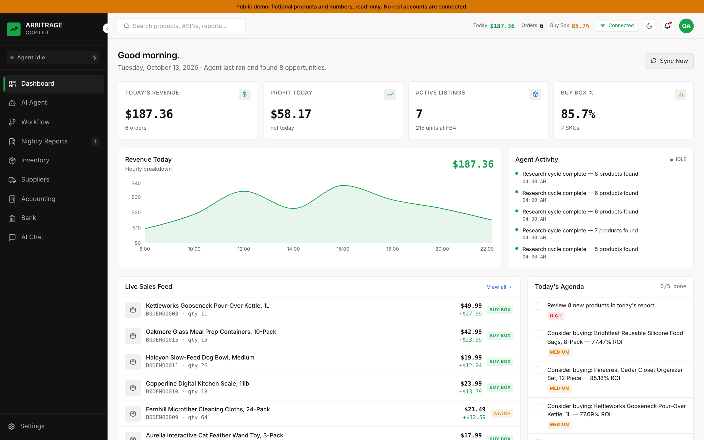
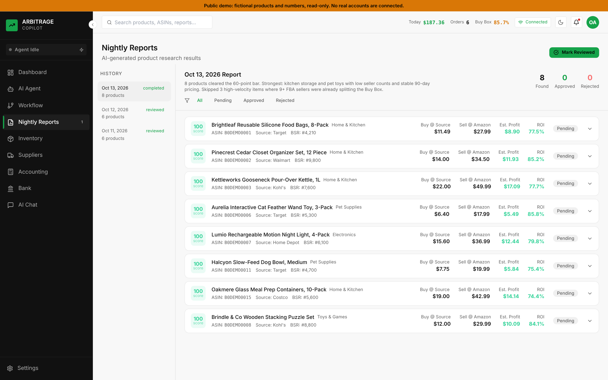
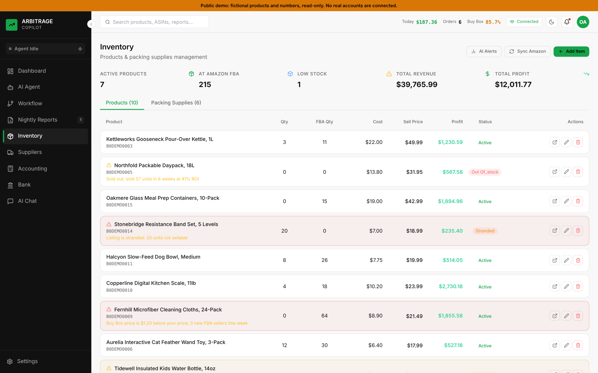
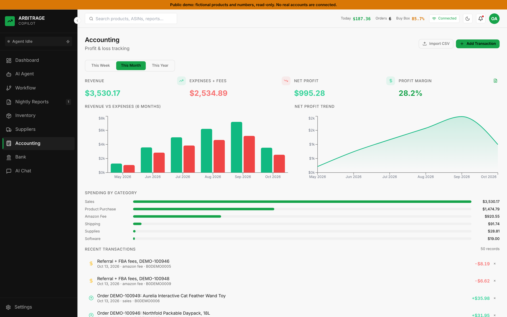

# Arbitrage Copilot

[](https://github.com/SahilH-spec/arbitrage-copilot/actions/workflows/ci.yml)

AI-powered Amazon online arbitrage business management app. Built with React + Express + PostgreSQL.
A Claude agent researches products every night, scores them against explicit criteria, and the app tracks
inventory, Buy Box position and profit across Amazon SP-API, Keepa, and a Plaid bank connection.

**Live demo: https://sahilh-spec.github.io/arbitrage-copilot/** (static, fictional data, no backend or API keys)

> I ran an Amazon arbitrage business and built this to run it. The live demo and screenshots use a fictional
> dataset (invented brands, ASINs and orders) from the app's demo mode.



| Nightly report: AI-scored products | Inventory with Buy Box and stranded-listing alerts |
|---|---|
|  |  |



## How it fits together

```
React + Vite UI ──► Express API (login required) ──► PostgreSQL (Drizzle ORM)
                         │
                         ├─ Claude: nightly research agent, report scoring, chat, inventory alerts
                         │    (optional Anthropic Managed Agent: its tool calls run on this server,
                         │     so Keepa/Amazon/Plaid secrets never leave it)
                         ├─ Amazon SP-API: orders, FBA inventory, listing prices
                         ├─ Keepa + Brave Search: price history and product research
                         └─ Plaid: business bank transactions into the ledger
```

## Features

- **AI Research Agent** — Runs nightly at 4 AM, researches products using Claude + Brave Search + Keepa
- **Daily Reports** — Curated product list with ROI scoring, criteria analysis, approve/reject workflow
- **Inventory Tracking** — Products + FBA sync + AI alert analysis + one-click repricing
- **Accounting** — P&L tracking, CSV import, charts, category breakdown
- **AI Chat** — Claude-powered business assistant for questions and analysis
- **Workflow Guide** — Step-by-step business process roadmap
- **Agent Control** — Configure schedule, thresholds, categories, permission level

## Quick Start (Local)

### 1. Prerequisites
- Node.js 18+
- PostgreSQL database

### 2. Clone & Install
```bash
git clone <your-repo>
cd arbitrage-copilot
npm install
cd frontend && npm install
cd ../backend && npm install
```

### 3. Environment Setup
```bash
cp .env.example .env
# Edit .env with your API keys
```

**Required for basic operation:**
- `DATABASE_URL` — PostgreSQL connection string
- `ANTHROPIC_API_KEY` — For AI chat and agent analysis

**Optional (adds more features):**
- `BRAVE_SEARCH_API_KEY` — For agent product research (get free at api.search.brave.com)
- `KEEPA_API_KEY` — For Amazon price history
- `AMAZON_SP_*` — For Amazon Seller account integration

### 4. Run Database Migrations
```bash
cd backend
npm run dev
# Migrations run automatically on startup
```

### 5. Start Development
```bash
# From root:
npm run dev
# Frontend: http://localhost:5173
# Backend API: http://localhost:3001
```

## Self-hosted deployment (Railway)

### 1. Create Railway Project
```bash
# Install Railway CLI
npm install -g @railway/cli
railway login
railway init
```

### 2. Add PostgreSQL
- In Railway dashboard: Add → Database → PostgreSQL
- Copy `DATABASE_URL` to your service variables

### 3. Set Environment Variables
In Railway → Your Service → Variables, add:
```
ANTHROPIC_API_KEY=sk-ant-...
BRAVE_SEARCH_API_KEY=BSA...
KEEPA_API_KEY=...
AMAZON_SP_APP_ID=...
AMAZON_SP_CLIENT_SECRET=...
AMAZON_SP_REFRESH_TOKEN=...
AMAZON_SELLER_ID=...
APP_PASSWORD=<12+ characters: the owner login>
JWT_SECRET=<random-64-char-hex>
ENCRYPTION_KEY=<random-64-char-hex>   # encrypts the Plaid token at rest; back it up
NODE_ENV=production
```
The server refuses to start in production without `APP_PASSWORD` and `JWT_SECRET`.

### 4. Deploy
```bash
git init
git add .
git commit -m "Initial commit"
railway up
```

Or connect GitHub repo in Railway dashboard for auto-deploy on push.

## API Keys Setup Guide

### Anthropic API (Required for AI)
1. Go to [console.anthropic.com](https://console.anthropic.com)
2. Create an account / log in
3. API Keys → Create Key
4. Add to `.env` as `ANTHROPIC_API_KEY`

### Brave Search API (For agent research)
1. Go to [api.search.brave.com](https://api.search.brave.com)
2. Sign up for Data for Search (free tier: 2,000 queries/month)
3. Create API key
4. Add to `.env` as `BRAVE_SEARCH_API_KEY`

### Keepa API (For price history)
1. Go to [keepa.com/#!api](https://keepa.com/#!api)
2. Subscribe to API plan (~$17/month for 100 tokens/minute)
3. Get API key from account settings
4. Add to `.env` as `KEEPA_API_KEY`

### Amazon SP-API (For seller account)
1. Go to Seller Central → Apps & Services → Develop Apps
2. Create a developer profile if needed
3. Register new application
4. Generate a refresh token via OAuth flow
5. Add all values to `.env`

Full SP-API setup guide: [developer.amazonservices.com](https://developer.amazonservices.com)

## Project Structure

```
arbitrage-copilot/
├── frontend/           # React + Vite + Tailwind
│   └── src/
│       ├── pages/      # Dashboard, Reports, Inventory, Accounting, Chat, Agent, Workflow
│       ├── components/ # Layout components (Sidebar, Header)
│       └── lib/        # API client, utilities
├── backend/            # Express + TypeScript
│   └── src/
│       ├── routes/     # API endpoints
│       ├── services/   # Claude, Keepa, Amazon SP-API, agent logic
│       └── db/         # Schema + migrations
├── .env.example        # All required environment variables
└── railway.toml        # Railway deployment config
```

## Product Scoring Criteria

The AI agent scores each product 0-100 based on:

| Criteria | Weight | Threshold |
|----------|--------|-----------|
| ROI | 25% | ≥ 30% |
| Sales Velocity | 20% | ≥ 30/month |
| Competition | 15% | ≤ 5 FBA sellers |
| Price Stability | 15% | < 20% 90-day drop |
| Amazon Presence | 10% | Low buy box % |
| Category Health | 10% | Not restricted |
| Profit Margin | 5% | ≥ 25% net |

Products scoring ≥ 60 appear in the nightly report.

## Security

This app holds API keys, an Amazon seller connection and a bank link, so it is locked down:

- **Login required.** Every `/api` route except `/api/health` needs a session (single owner password,
  constant-time check, signed 12-hour `HttpOnly` + `SameSite=Strict` + `Secure` cookie). Login is rate-limited
  (8 attempts / 15 min / IP).
- **Fails closed.** In production the server will not boot without `APP_PASSWORD`, a strong `JWT_SECRET`, and
  (when Plaid is configured) a valid `ENCRYPTION_KEY`.
- **Secrets at rest.** The Plaid access token is stored AES-256-GCM encrypted. A pre-existing plaintext token is
  re-encrypted the first time it is used. The settings API never returns or accepts internal keys.
- **Secrets stay on the server.** The Managed Agent's tool calls (Keepa, Amazon, repricing, saving reports) execute
  here; third-party keys are never sent to the agent sandbox.
- **Tested.** `scripts/smoke-test.sh` runs in CI against a real Postgres: unauthenticated requests get 401, forged
  tokens are rejected, and demo mode is read-only.

## Public demo mode

Two ways to show the app without exposing real data:

- **Static demo on GitHub Pages** (what the live link above runs): the React app is built with
  `VITE_STATIC_DEMO=true`. It makes no network calls to a backend; every screen reads fictional JSON fixtures
  from `frontend/public/demo-api/`, dates are shifted so the data always looks current, writes are disabled,
  and the AI chat streams a canned reply. `.github/workflows/pages.yml` builds and publishes it on every push to `main`.
  To refresh the fixtures: run the backend with `DEMO_MODE=true` against an empty database, then
  `node scripts/record-static-demo.mjs http://localhost:3001`.
- **Server demo mode** (`DEMO_MODE=true`): the real backend serving the same fictional dataset read-only, with every
  integration disabled. It refuses to start against a database that holds real data. See `docs/DEPLOY.md`.

## Support

- AI Chat tab: Ask Claude anything about your business
- Workflow tab: Step-by-step process guide
- Agent Control → Settings: Adjust all thresholds
